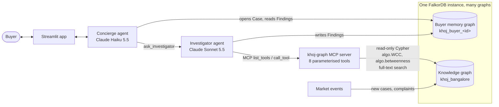
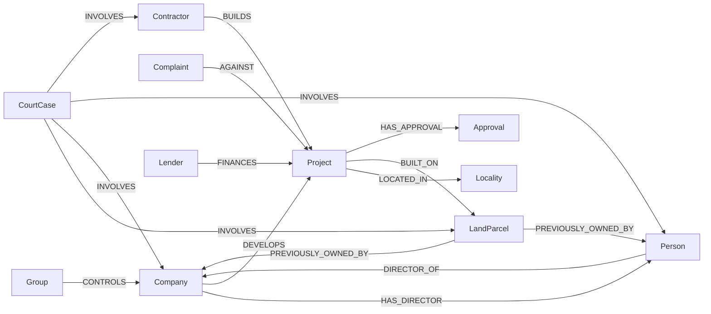
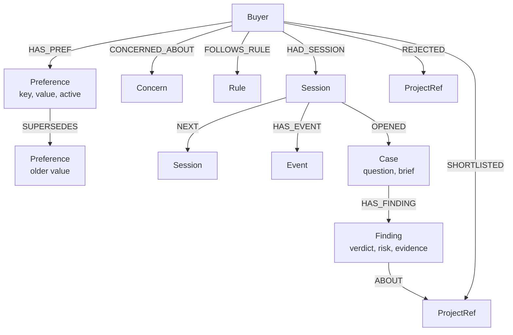

# Khoj

**Graph-powered due diligence for Bangalore homebuyers, built on FalkorDB.**

A new residential launch can look spotless: RERA registered, A-khata land, all approvals in place, a fresh company with no complaints. Then you follow the connections. The company shares two directors with a developer that went insolvent and left two projects stalled. The plot's previous owner is in a pending title suit. The contractor is behind on three other projects.

None of that sits in a single record. It lives in the relationships, so Khoj puts the market in a graph and gives AI agents that graph as their context. The agents follow the connections, score the risk, explain every score as a path you can see, and remember each buyer across sessions.

**Built with** FalkorDB · Cypher and graph algorithms (WCC, betweenness) · MCP · Claude or Gemini · Streamlit · Python

> Demo data is synthetic. Every developer, company, person and case number is fictional; only locality names are real.

---

## What it does

Ask *"Is Skyvista Altura in Sarjapur Road a safe buy? I want a 3BHK under 1.7 Cr."*

1. The **Concierge** agent saves your budget and BHK to your memory graph and hands the question to the **Investigator** by opening a `Case` node in that graph.
2. The **Investigator** resolves the project against the graph, checks the buyer's memory for earlier findings, reads the surface profile, then runs the graph risk model and follows the evidence:
   - **directors → their other companies**, using FalkorDB's Weakly Connected Components to expose the hidden group behind a brand;
   - **betweenness centrality** to find directors who bridge otherwise separate companies;
   - **land → previous owner → court cases** for title risk;
   - **contractor → its other projects and court cases** for execution risk.
3. It writes a `Finding` into the case. The Concierge reads the case back from the graph and answers with a verdict, the score and the evidence chains.
4. Next week, when you open a new session, Khoj re-scores your shortlist against the graph and tells you what changed. For example: *"Whispering Woods went from 0 to 52: its contractor, Sterling EPC, now faces an insolvency petition."*

**The agents never write Cypher.** They discover a fixed catalogue of eight human-written, parameterised, read-only graph tools over **MCP** and fill in arguments. Project ids are resolved against the graph before any traversal runs, and every tool result carries one of four statuses:

| Status | Meaning |
|---|---|
| `ANSWERED_WITH_PATH` | The graph held the relationships; the paths come back with the answer. |
| `ANSWERED_FROM_MEMORY` | An earlier finding from the buyer's memory graph, with the date it was made. |
| `NOT_IN_GRAPH` | The project exists but nothing connects it as asked. This is reported as "no known connection", never as "safe". |
| `UNKNOWN_ENTITY` | The name or id doesn't resolve, so no traversal runs. |

**Agents propose, code disposes.** Before a finding is saved, a deterministic verifier ([`khoj/verifier.py`](khoj/verifier.py)) recomputes the facts from the graph and rejects the draft if:
- the verdict doesn't follow from fixed rules (AVOID above 60 or with a pending title suit; SAFE only below 30 with no red flag within one hop and an untruncated search);
- an evidence chain names an entity that no graph tool returned for that project;
- a CAUTION or AVOID finding has no evidence.

The model's own risk number is always replaced with the computed one. Rejected drafts are kept in the case file for audit, and the agent has to fix the finding and try again. After the answer, a grounding check flags any entity name or "NN/100" score in the reply that didn't come from the graph or memory in that turn.

**No silent truncation.** The risk query asks for one row more than its path limit; if that sentinel row comes back, the result is marked truncated, and the verifier won't allow SAFE.

**Remove FalkorDB and nothing works.** The risk score is a computation over graph paths, the hidden-group and key-person findings are graph algorithms, and buyer memory and agent handoffs are graphs.

## Does the graph actually find the risk?

We built a held-out benchmark ([`scripts/benchmark.py`](scripts/benchmark.py), full report in [`docs/benchmark.md`](docs/benchmark.md)). It injects 200 new projects into a separate copy of the graph with a different random seed. **Every one has a clean surface**: freshly registered, approvals granted, A-khata land, no complaints. Half hide one of four risk patterns, in weak and strong variants; half are clean controls with deliberate confounders (same locality and lender as a stalled project, land bought from an aggregator that also sold a disputed plot).

| Method | AUC | Recall | False positives |
|---|---|---|---|
| Surface check (the project's own records, what a RERA portal shows) | 0.50 | 0% | 0% |
| Graph, 2 hops only | 0.69 | 25% | 0% |
| Graph without the structural rules | 0.62 | 96% | 93% |
| **Khoj (full model)** | **1.00** | **81%** | **0%** |

- **Remove the relationships and nothing is found.** The risk exists only in the graph.
- **The structural rules matter as much as the graph.** Without them, the confounders make 93% of clean projects look risky.
- **Every Cypher score was recomputed by a pure-Python path enumeration: 0 mismatches** across 200 projects.
- A full risk trace takes **2.9 ms** (p50) on the 3,696-node benchmark graph.
- Misses are reported, not hidden: weak contractor and key-person cases sit below the threshold. Path summation adds nothing measurable on this benchmark. One model change (title-chain hops carry no distance decay) was made after the first run; the report discloses it and gives the before and after numbers.

## Architecture



- **One shared knowledge graph** of the market (`khoj_bangalore`).
- **One isolated graph per buyer** (`khoj_buyer_<id>`), using FalkorDB's multi-graph support. A buyer's memory cannot leak into another buyer's queries, and forgetting a buyer means deleting one graph.
- **Tools over MCP.** [`khoj/mcp_server.py`](khoj/mcp_server.py) exposes the graph tools as an MCP server. The agents discover and call them through the MCP client's in-memory transport ([`khoj/mcp_client.py`](khoj/mcp_client.py)), and any other MCP client can use them with `python -m khoj.mcp_server` over stdio.
- **Two agents with separate tools.** The Concierge only touches memory; the Investigator only touches the market graph. They coordinate through state written to the graph, not through hidden prompt passing.

## Graph data model

### Knowledge graph (`khoj_bangalore`)



| Label | Key properties |
|---|---|
| `Group` | brand, `brand_since`, `status` |
| `Company` | `status` (active / insolvency / struck_off), `incorporated` |
| `Person` | `role` (director / landowner) |
| `Project` | `status` (launch / under_construction / delivered / stalled), `launch_year`, `promised_possession`, `delay_months`, `bhk` (list), `price_min_lakh`, `price_max_lakh`, `units`, `rera_id` |
| `LandParcel` | `survey_no`, `village`, `khata` (A / B), `acres` |
| `Approval` | `type` (RERA, plan, CC, OC), `status`, `year` |
| `Complaint` | `forum`, `category`, `status`, `filed` |
| `CourtCase` | `case_no`, `court`, `nature` (title_dispute / insolvency / fraud / cheque_bounce), `status` |
| `Contractor`, `Lender`, `Locality` | name and basics |

Every node has `id`, `kind`, `name` and `created_at`. Red-flag nodes also carry the **`:RedFlag`** label with a `severity` (0–1) and a `reason` (see [`khoj/flags.py`](khoj/flags.py)). `HAS_DIRECTOR` is the reverse of `DIRECTOR_OF`; it exists so FalkorDB's betweenness algorithm, which follows edge direction, measures the undirected director network.

The dataset has 847 nodes and 1,256 edges: 91 projects, 46 companies, 100 people, 16 brands, 177 complaints and 9 court cases. It is generated by [`data/generate.py`](data/generate.py) (seeded, reproducible) with four stories planted on top of random background data:

| Story | Project | What the graph reveals |
|---|---|---|
| Phoenix developer | Skyvista Altura | Its directors ran Northstar Habitats (insolvent, NCLT case) and its sister LLP (struck off); two projects stalled. **Risk 85, HIGH.** |
| Disputed land | Kaveri Crest Serene | The plot and its previous owner are named in a pending title suit. **Risk 70, HIGH.** |
| Contractor contagion | Hoysala Orchid Springs | A 30-year brand, but its contractor is 18–26 months late on three projects and has a pending cheque-bounce case. **Risk 43, MEDIUM.** |
| Key person | Meridian Tranquil | One director links six companies across four brands, two of them failed. He ranks #1 of 34 directors by betweenness. **Risk 49, MEDIUM.** |

The three clean Sarjapur Road projects score 0 and are offered as alternatives.

### Buyer memory graph (`khoj_buyer_<id>`)



- **Semantic memory:** preferences, with history (`SUPERSEDES`), and concerns.
- **Procedural memory:** rules such as *"always check the land title."* They are copied into every case brief, so they change how the Investigator works.
- **Episodic memory:** sessions linked in order, with events and the cases opened in each.
- **Decisions:** shortlist entries store the risk at the time and when it was last checked. Rejected projects keep the reason.
- `ProjectRef.project_id` points into the knowledge graph, which is how the watchlist re-check works.

## The risk model

Every red flag within four hops pushes risk onto a project along **every** path between them:

```
K(p) = Σ over paths P from p to a red flag f:   severity(f) · β^d(P) · Π w(r) for r in P
score(p) = 100 · (1 − e^(−K))           β = 0.6
d(P) = |P| − 1 − (number of PREVIOUSLY_OWNED_BY hops in P)
```

This is Katz centrality restricted to red-flag targets and bounded paths. The saturating transform is the noisy-OR / survival form: if each path is an independent hazard, the chance that none of them materialises decays like e^(−K), so the score stays in [0, 100], piles of minor evidence show diminishing returns, and contributions stay additive in K so the top paths can be ranked by share. Choices that matter:

- **Paths are summed, not just the shortest one.** Two shared directors are stronger evidence than one, and a contractor late on three projects is worse than one late on one. (Honestly: on our benchmark this changes scores but not rankings.)
- **Title-chain hops don't decay.** A buyer inherits the vendor's title, so a suit against the plot's previous owner transfers to the plot at full strength (times the 0.9 edge weight).
- **Edge weights** `w(r)`: a shared contractor (0.75) or shared brand (0.7) is weaker evidence than a directorship (1.0).
- **No pass-through projects.** A troubled project is itself a red flag; its complaints are not counted again for its neighbours. Without this rule the median project scored 94.
- **At most one `PREVIOUSLY_OWNED_BY` edge**, so a land aggregator that once owned many plots does not connect unrelated projects.
- `LOCATED_IN` and `FINANCES` are ignored: sharing a locality or a bank says nothing.

After calibration the background median is 28 (LOW). Of 91 projects, 48 score LOW, 24 MEDIUM and 19 HIGH.

## Cypher and algorithms the product depends on

**Risk paths** ([`khoj/risk.py`](khoj/risk.py)): one variable-length match per project, scored in Python.

```cypher
MATCH path = (p:Project {id: $id})-[:DEVELOPS|DIRECTOR_OF|CONTROLS|BUILT_ON|PREVIOUSLY_OWNED_BY|INVOLVES|AGAINST|HAS_APPROVAL|BUILDS*1..4]-(f:RedFlag)
WHERE f <> p
  AND none(n IN nodes(path)[1..-1] WHERE n.kind = 'Project')
  AND size([r IN relationships(path) WHERE type(r) = 'PREVIOUSLY_OWNED_BY']) <= 1
RETURN f.id AS flag_id, f.reason AS reason, f.severity AS severity, f.created_at AS created_at,
       length(path) AS hops,
       [n IN nodes(path) | {id: n.id, kind: n.kind, name: n.name}] AS nodes,
       [r IN relationships(path) | type(r)] AS rels
```

**Hidden developer group**: Weakly Connected Components on the directorship graph ([`khoj/tools.py`](khoj/tools.py), `developer_network`).

```cypher
CALL algo.WCC({nodeLabels: ['Person', 'Company'], relationshipTypes: ['DIRECTOR_OF']})
YIELD node, componentId
RETURN node.id AS id, componentId AS component
```

**Key people**: betweenness centrality (`key_people`).

```cypher
CALL algo.betweenness({nodeLabels: ['Person', 'Company'], relationshipTypes: ['DIRECTOR_OF', 'HAS_DIRECTOR']})
YIELD node, score
WITH node, score WHERE node.kind = 'Person' AND score > 0
RETURN node.id AS id, node.name AS name, score ORDER BY score DESC
```

**Land title chain** (`land_title_check`):

```cypher
MATCH (p:Project {id: $id})-[:BUILT_ON]->(l:LandParcel)
OPTIONAL MATCH (l)-[po:PREVIOUSLY_OWNED_BY]->(o)
OPTIONAL MATCH (k:CourtCase)-[:INVOLVES]->(x) WHERE x = l OR x = o
RETURN l.name AS land, l.khata AS khata, o.name AS previous_owner, po.until AS owned_until,
       collect(DISTINCT k {.case_no, .court, .nature, .status, .parties}) AS cases
```

**Contractor track record** (`contractor_record`):

```cypher
MATCH (p:Project {id: $id})<-[:BUILDS]-(con:Contractor)
OPTIONAL MATCH (con)-[:BUILDS]->(o:Project) WHERE o <> p
OPTIONAL MATCH (k:CourtCase)-[:INVOLVES]->(con)
WITH con, collect(DISTINCT o {.id, .name, .status, .delay_months, .locality}) AS others,
     collect(DISTINCT k {.case_no, .court, .nature, .status, .filed}) AS cases
RETURN con.id AS contractor_id, con.name AS contractor, others, cases
```

**Typo-tolerant project search**: full-text index with prefix, then fuzzy, matching.

```cypher
CALL db.idx.fulltext.queryNodes('Project', 'skyvist* altur*') YIELD node RETURN node.id
CALL db.idx.fulltext.queryNodes('Project', '%skyvsta% %altra%') YIELD node RETURN node.id
```

**Red-flag rules** ([`khoj/flags.py`](khoj/flags.py)), re-run whenever data changes, for example:

```cypher
MATCH (k:CourtCase) WHERE k.status = 'pending'
SET k:RedFlag, k.severity = CASE k.nature WHEN 'title_dispute' THEN 0.95 WHEN 'fraud' THEN 0.8
                                          WHEN 'insolvency' THEN 0.75 ELSE 0.3 END,
    k.reason = 'Pending ' + replace(k.nature, '_', ' ') + ' case in ' + k.court
```

**Memory: a preference update that keeps history** ([`khoj/memory.py`](khoj/memory.py)):

```cypher
MATCH (b:Buyer {id: $bid})
OPTIONAL MATCH (b)-[:HAS_PREF]->(old:Preference {key: $key, active: true})
CREATE (b)-[:HAS_PREF]->(new:Preference {key: $key, value: $value, since: $ts, active: true})
WITH old, new WHERE old IS NOT NULL
SET old.active = false, old.until = $ts
CREATE (new)-[:SUPERSEDES]->(old)
```

**Agent handoff through the graph:**

```cypher
MATCH (s:Session {id: $sid})
CREATE (s)-[:OPENED]->(:Case {id: $cid, question: $q, brief: $brief, status: 'open', opened_at: $ts})

MATCH (c:Case {id: $cid})
MERGE (w:ProjectRef {project_id: $pid}) ON CREATE SET w.name = $name
CREATE (c)-[:HAS_FINDING]->(f:Finding {project_id: $pid, verdict: $verdict, summary: $summary,
                                        risk_score: $risk, evidence: $evidence, ts: $ts})
CREATE (f)-[:ABOUT]->(w)
```

All investigative queries run through `ro_query` (`GRAPH.RO_QUERY`), so they cannot write. The risk query binds `path` and reads `relationships(path)`, so parallel paths are enumerated individually rather than collapsed. Every query an agent runs, and the status of every result, appears in the app's **Agent trace** tab.

### Using the tools from another MCP client

```json
{ "mcpServers": { "khoj-graph": { "command": "python", "args": ["-m", "khoj.mcp_server"],
                                  "cwd": "/path/to/khoj" } } }
```

## Run it

### 1. FalkorDB

Either start a free instance on [FalkorDB Cloud](https://app.falkordb.cloud), or run it locally:

```bash
docker run -p 6379:6379 -p 3000:3000 -it --rm falkordb/falkordb:latest
```

(FalkorDB Browser is then at http://localhost:3000.)

### 2. Install and configure

```bash
git clone <this repo> && cd khoj
python -m venv .venv && source .venv/bin/activate     # Windows: .venv\Scripts\activate
pip install -r requirements.txt
cp .env.example .env                                   # then fill it in
```

`.env` needs the FalkorDB host, port and credentials, and an LLM key:

- **Claude** (default): `LLM_PROVIDER=anthropic` and `ANTHROPIC_API_KEY`.
- **Gemini** (free tier): `LLM_PROVIDER=gemini` and `GEMINI_API_KEY` from Google AI Studio. Both agents default to `gemini-3.8-flash` through Google's OpenAI-compatible endpoint. Tool calls are sent back exactly as returned, so Gemini 3's thought signatures survive multi-step tool use, and rate-limit errors are retried with backoff.

### 3. Load the data and run

```bash
python scripts/load_data.py --check     # builds the knowledge graph (about 1 second)
streamlit run app.py
```

The app also loads the data automatically if the graph is missing.

### Recorded runs (no API key)

`python scripts/record_replays.py` runs the real agents on the example questions and the memory scenario, and saves every event, tool result and answer to `data/replays/`. With `DEMO_MODE=replay` (or no API key), the app plays these back step by step, so anyone can explore it without a key, cost or waiting. Live mode is capped at `MAX_LIVE_QUESTIONS` per visitor.

### Tests and benchmark

```bash
pytest -q                          # 61 tests against a live FalkorDB, no LLM calls (about 4 s)
python scripts/benchmark.py        # held-out benchmark, writes docs/benchmark.md
python scripts/falkordb_repros.py  # engine behaviours we documented (docs/falkordb-notes.md)
```

CI runs all of this against a FalkorDB service container on every push. To regenerate the synthetic data: `python data/generate.py`. For a terminal-only check: `python scripts/chat_cli.py "Is Skyvista Altura safe?"`.

### Deploy (Streamlit Community Cloud)

Push the repo, create an app pointing at `app.py`, and paste the `.env` values into **Secrets** as TOML (`FALKORDB_HOST = "..."` and so on). Root-level secrets become environment variables, which `khoj/config.py` reads.

## Demo walkthrough

1. Click **"Is Skyvista Altura in Sarjapur Road a safe buy?"** The project looks clean on the surface; the stamp says AVOID 85, and the evidence graph shows the Northstar chain.
2. Ask *"Who is really behind Meridian Tranquil?"* Betweenness puts Suresh Narayan at #1 of 34 directors.
3. Say *"Shortlist Banyan Grove Whispering Woods and Greenfield Sarjapur Greens. Always check land title for me."* This stores the shortlist and a procedural rule.
4. In the sidebar, **add an event to the graph** (for example, Sterling EPC faces an insolvency petition), then **start a new session**. Khoj greets you with what changed and the new evidence path.
5. Open **Buyer memory** to see the memory graph, and **Agent trace** to see every Cypher query and the handoff.

## Project structure

```
app.py                 Streamlit interface
khoj/
  agent.py             Concierge + Investigator, tool loop, prompts
  tools.py             graph tools (Cypher, WCC, betweenness, full-text), entity resolution, statuses
  mcp_server.py        the tools as an MCP server
  mcp_client.py        how the agents discover and call them over MCP
  verifier.py          deterministic checks on every finding before it is saved
  replay.py            recorded runs for the no-key demo
  risk.py              Katz-style risk model
  flags.py             red-flag rules (Cypher)
  memory.py            buyer memory graphs, cases and findings, watchlist
  events.py            live market events
  llm.py               Anthropic / OpenAI-compatible adapter
  loader.py, db.py, config.py, ui.py
data/generate.py       synthetic data generator (seeded) -> data/seed.json
scripts/               load_data.py, chat_cli.py, benchmark.py, record_replays.py, falkordb_repros.py
tests/                 61 pytest tests (live FalkorDB)
docs/                  benchmark.md, falkordb-notes.md
```


## Limitations and next steps

- The data is synthetic. A real version would ingest K-RERA project and complaint records, MCA company and director filings, eCourts case data and Bhoomi land records, all of which map directly onto this schema.
- The red-flag severities and edge weights are hand-set. With labelled outcomes (projects that actually stalled), they could be fitted.
- Engine behaviours we ran into (direction-only betweenness, no undirected `shortestPath`) are documented with reproductions in [`docs/falkordb-notes.md`](docs/falkordb-notes.md).
- The risk model scores one project at a time. Precomputing scores and updating only the neighbourhood of a changed node would scale it to a whole city.

## License

MIT. See [LICENSE](LICENSE).
